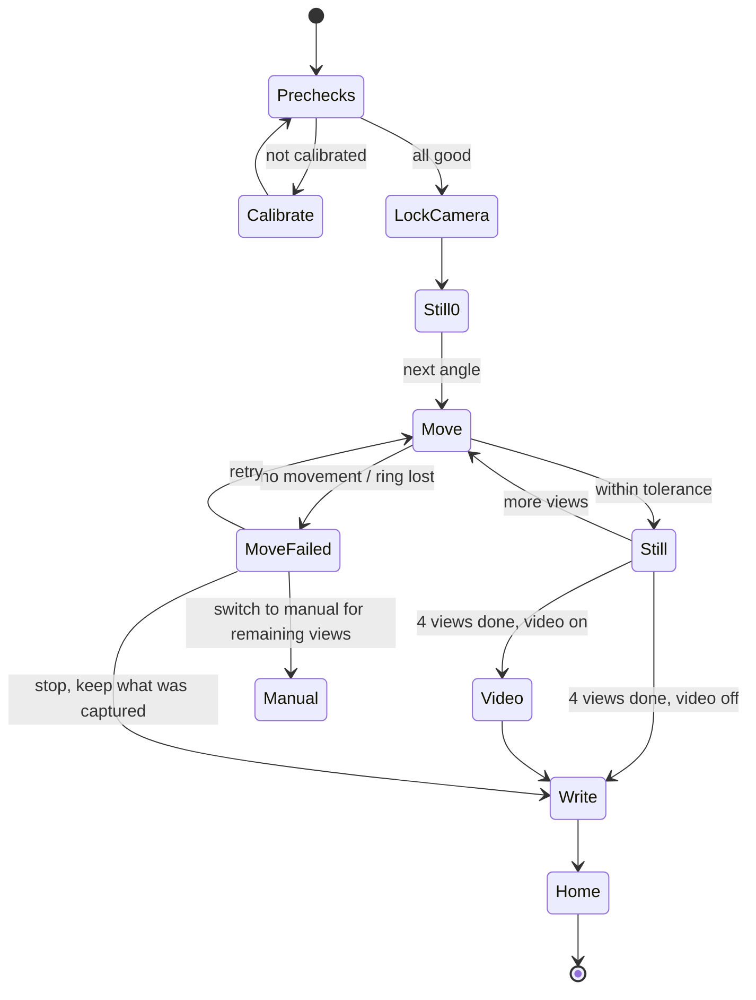
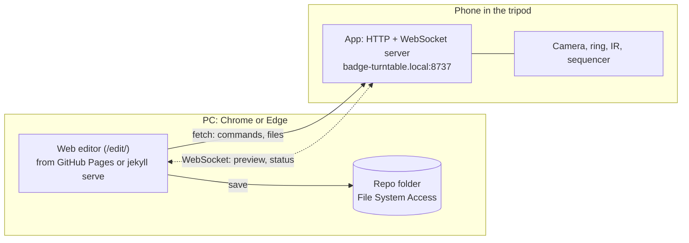

# Badge Turntable — Spec

Draft 5 · Nov 5, 2026. Background research (IR APIs, viewer libraries, hosting limits) is in [Overview.md](Overview.md). The encoder ring has its own page, [encoder-ring/README.md](encoder-ring/README.md). Where documents disagree, this spec wins.

## App identity

| | |
| --- | --- |
| Name | Badge Turntable |
| Application ID / package | `org.snurkle.badgeturntable` |
| Icon | A con badge on a lanyard, standing on a turntable platter, with a curved arrow around the base to suggest rotation. It's an adaptive icon (separate foreground and background layers) plus a monochrome layer for Android 13+ themed icons. |

## Summary

An Android app, written in Java, that photographs a badge on an IR-controlled turntable inside a light box. The phone's IR blaster drives the turntable. A printed encoder ring on the turntable tells the app the table's real angle, so every move can be checked.

One capture produces four high-resolution stills (0°, 90°, 180°, 270°, with 0° being the front of the badge) and an optional 360° spin video. Extra shots, such as the lanyard or add-ons installed, can be added to the same badge. Everything is written into a badge folder laid out like the repo's, including an `index.md` filled from [_template/index.md](https://github.com/hamster/badges/blob/main/_template/index.md). The folder is saved locally and optionally synced to a Samba share. The rest of the badge details are filled in later on a PC with the web editor.

Typing on a phone clamped in a tripod is awkward, so the app can also be driven from the PC. The web editor connects to the phone over the local network, shows a live preview, runs calibration and captures, and saves the photos straight into the repo with the badge details. See [Remote control from the editor](#remote-control-from-the-editor).

## Platform and stack

| Area | Choice | Notes |
| --- | --- | --- |
| Language | Java 17 | Kotlin was considered. Nothing here needs it: every library below has a Java API. The only thing Java rules out is Jetpack Compose, and Views/XML with Material 3 components is fine for these screens. |
| Android | minSdk 31 (Android 12), targetSdk 36 | Android 12+ gives Camera2 maximum-resolution sensor mode and a modern permissions model. |
| Camera | CameraX + Camera2 interop | CameraX handles lifecycle and use-case binding. Camera2 interop (`Camera2Interop` / `Camera2CameraControl`) gives manual ISO, shutter, focus distance and white balance. |
| IR | `ConsumerIrManager` | Built-in API, no library needed. Needs the `TRANSMIT_IR` permission (a normal permission, granted at install). |
| Encoder ring vision | OpenCV Android SDK (`ArucoDetector` in `objdetect`) | Java bindings, available from Maven Central. |
| Video post-processing | Media3 Transformer | Trim, scale, speed change and H.264 re-encode in Java. |
| Samba | smbj | Pure-Java SMB2/3 client. |
| IR learning (optional) | usb-serial-for-android | Reads raw timings from a USB IR receiver (see [Turntable profiles](#turntable-profiles)). |
| Background sync | WorkManager | Retries, network constraints. |
| Secrets | Android Keystore | Encrypts the Samba password at rest. `androidx.security-crypto` is deprecated, so don't use it. |
| Remote control server | Built in (`remote.HttpServer`, `remote.WebSocket`), `java.net` only | About 600 lines: HTTP/1.1 with keep-alive and the WebSocket upgrade, unit tested on the JVM. NanoHTTPD was the plan, but its WebSocket close codes are a fixed enum, so it can't send the API's 4401/4408/4409, and it has been unmaintained since 2016. |
| Local name | Built in (`remote.MdnsResponder`) | A minimal mDNS responder: answers A queries for `badge-turntable.local` and advertises an `_badge-turntable._tcp` service with SRV and TXT records. It doesn't probe for name conflicts. Needs a Wi-Fi `MulticastLock` while running. Chosen over JmDNS to avoid a dependency that also pulls in SLF4J. |

### Target phone: OnePlus 13

- It has an IR blaster on its top edge, so turntable control needs no extra hardware.
- It ships with Android 15, so it's well above minSdk.
- It has three rear cameras: main, 3× telephoto and ultrawide (the ultrawide doubles as macro).
- **Unknowns:** how much manual control (ISO, shutter, focus distance, Kelvin white balance) OnePlus exposes to third-party apps through Camera2, and which physical lenses an app can select. Phase 1 starts with a **capabilities probe** screen that lists the hardware level, capabilities and lenses, so the controls offered match what the phone actually allows.
- **Probe results (Nov 4, 2026):** the phone reports itself as OnePlus CPH2749 on Android 16 (API 36).
  - **IR blaster:** present, carriers 20–60 kHz, so 38 kHz NEC is fine.
  - **Cameras:** every camera is `LEVEL_3` with `MANUAL_SENSOR`, `MANUAL_POST_PROCESSING`, RAW, burst and 10-bit, so manual ISO, shutter, focus distance and white balance are all available to the app. Sensor timestamps are realtime, so video trims will line up with the angle log.
  - **Lenses:** camera 0 is a logical back camera made of physical cameras 2, 3 and 4. All three are also listed on their own, so each lens can be selected directly.

    | Camera | Lens | Focal length | Closest focus | ISO | Max JPEG |
    | --- | --- | --- | --- | --- | --- |
    | 0 | Logical back camera (2, 3, 4) | 5.59 mm | 10 cm | 100–6400 | 4096×3072 |
    | 2 | Main | 5.59 mm | 10 cm | 100–6400 | 4096×3072 |
    | 3 | Ultrawide / macro | 2.31 mm | 3.5 cm | 100–6200 | 4096×3072 |
    | 4 | Telephoto | 12.19 mm | 40 cm | 100–16000 | 4096×3072 |
    | 1 | Front | 3.23 mm | 14.2 cm | 100–3200 | 3280×2464 |

    The telephoto can't focus closer than 40 cm, so the tripod distance decides whether it's usable in the light box.
- **IR reach:** the phone sits on a tripod outside the light box, looking in through the front opening. The blaster is on the phone's top edge, so it points up (in portrait) or sideways (in landscape), not into the box. The JAYEGT's IR receiver looks to be on the **back** of the base, behind the indicator LED, facing away from the camera.
  - **Orientation:** the base doesn't turn, only the platter does, so the base can be set in the box with its back toward the opening. That puts the receiver facing the camera. The back-panel buttons stay reachable from the front, and the encoder ring is unaffected because it reads the platter rim.
  - **Plan:** a small clip-on reflector over the blaster (white card or foil at about 45°) that bounces the beam forward through the opening toward the receiver. With the base the usual way round, the beam would have to bounce off the light box's back wall instead, which white walls may do well enough. Phase 3 tests that.
  - **Fallback:** a cheap external IR LED aimed at the receiver.
  - Phase 3 tests both.

## Screens

1. **Sessions (home).** A list of capture sessions, each with a thumbnail, title, con/year, `badge_id`, capture count and, with Samba set up, its sync status (not synced / queued / synced / failed) and a **Sync** button. Actions: **New session**, open a session to **edit/append**, long-press for **Sync** and **Delete**, and **Sync all to Samba** in the menu.
2. **New/edit session.** Badge identity fields, session options, and the list of captured files, which can be re-captioned, reordered or deleted. See [Sessions](#sessions).
3. **Capture** (called **Camera** when opened on its own). A full-screen live preview with camera controls, the turntable status, the **Capture** and **Extra shot** buttons, and the auto/manual toggle. Everything happens here, including calibration. It opens from a session, or from the **Camera** button on the Sessions screen without one (*setup mode*), to frame the light box and calibrate without making a badge first. In setup mode, captures go to the shots held for the editor, so **Capture** and **Extra shot** only appear while remote control is on. While a job runs, **Extra shot** becomes **Stop**, and in manual mode **Capture** becomes **Ready**.
4. **Settings.** Remote control, Samba, turntable/IR, capture defaults, calibration status and the capabilities probe.

Every screen is landscape only, either way round (`sensorLandscape`), to suit the phone lying sideways in the tripod. Turning it end over end doesn't restart the Capture screen, so the app updates the camera's target rotation itself, keeping stills, video and the ring frames upright.

When remote control is on, the Capture screen also shows the phone's name, address and pairing code, plus which PC is connected, and the app opens straight on the Camera screen (Back goes to Sessions). With the editor doing the typing, screens 1 and 2 are only needed when using the phone on its own.

## Camera preview and controls

The preview shows the light box: the whole 4:3 frame, as the stills are, in the middle of the landscape screen. The remote-control address and pairing code sit centred across the top (clear of Android's camera-in-use indicator), the ring reading is two fixed lines at the top of the left column with **Set front** below it, a line across the bottom shows what's happening, and the buttons sit in the columns either side, so nothing covers the picture or the ring.

- **Lens:** a **Lens** button cycles through the back cameras CameraX can bind. It's hidden when there's only one (the OnePlus 9 Pro offers only its logical camera, which picks a lens as it zooms; the OnePlus 13 lists each lens).
- **Zoom:** pinch, or **−** and **+** (×1.25 a press). The readout between them shows the zoom; tap it to go back to 1×.
- **Focus:** tap to focus at a point for a few seconds, then continuous AF returns (focus only: metering exposure too made the picture jump, and holding focus on a tap at the background left the ring blurred). Captures lock focus on the centre themselves. The editor adds a focus lock and manual focus distance when the device reports `MANUAL_SENSOR`, and its click on the preview holds focus on that point until it's cleared.
- **Exposure:** auto with EV compensation (**EV −** and **EV +**), or manual ISO and shutter speed from the editor when supported. Exposure lock.
- **White balance:** auto and presets (daylight, cloudy, incandescent, fluorescent), and a lock from the editor. Manual Kelvin isn't done yet.
- **Guides** (a switch, remembered): a rule-of-thirds grid, a dashed centre line, and the **ring zone**, a box low in the frame where the ring should sit. It turns green when 8 or more markers are read, all inside the box, and amber with fewer or with markers outside it. The state only changes once it has held for 0.6 s, because the count varies from frame to frame.
- **Always shown:** a small box on each marker being read, and the turntable axis the ring fit found. The axis turns green ("Axis centred") within 2% of the centre line, which means the camera is centred on the table.

The light box doesn't change between badges, so all camera settings are saved as a **light box profile** and restored on launch. During a capture sequence, AF, AE and AWB are locked from the moment **Capture** is pressed, so all four stills and the video match.

## Turntable control

### Turntable profiles

The app ships with a profile for your turntable, but any turntable can be set up. **Settings → Turntable** has a model dropdown:

- **The built-in model(s):** codes, control type and button roles come preset, so it works out of the box. More presets can be added as people contribute them. The first preset is the **JAYEGT 5.74 in motorized display stand** (remote-control version):

  | Feature | JAYEGT 5.74 in |
  | --- | --- |
  | Platter | 145.3 mm diameter, measured (456.5 mm circumference), black. Rim height 9.6 mm, with a slight draft: 145.25 to 145.9 mm across its height. Generate the ring at 460.9 mm: the ZD500 feeds about 0.8% short, so a band generated for 456.5 mm printed at about 452.9 mm and left a 4.46 mm gap. |
  | Control type | Continuous + positions |
  | Remote: motion | On/Pause, Turn Left, Turn Right, +Speed, −Speed. On/Pause toggles; after a pause in intermittent mode it resumes in continuous mode. Turn Left/Right from rest always starts continuous rotation that way, so the app starts moves with Turn Right. |
  | Remote: modes | Resume Continuous Rotation, Intermittent Rotation. Intermittent turns one way and stops at uneven intervals of about 120°, so the app doesn't use it. |
  | Remote: swing | 45°, 90°, 180°. These are **not steps**: they set how far the platter rocks back and forth in swing mode, and start swinging from rest. Not used by the app. |
  | Remote: homing | Set Origin Position, Back to Set Position |
  | Remote: step | The unlabeled bottom button (NEC 0x46) advances 90° and stops. This is the app's step for each view. It's always 90°: the ASA button doesn't change it. |
  | Speeds | 8, 15 and 30 s per revolution |
  | Base buttons (back) | **R/L** (direction), **SR** (speed: 8, 15 or 30 s per revolution; holding it stops the rotation), **ASA** (starts swing mode; pressing it again changes the swing angle, like the remote's 45/90/180 buttons. It doesn't affect the step). SR and ASA have no IR codes: of the [unused codes](ir-tools/README.md#jayegt-574-in-remote) on the remote this one is based on, only 0x19 does anything, and it duplicates On/Pause. |
  | IR receiver | Probably behind the indicator LED on the back of the base (to confirm: cover it and check that the remote stops working) |
  | Power | Rechargeable battery and no power switch: it stays on until the battery runs flat. A tiny red charging LED sits under the ASA button. Keep it on USB power while capturing: a flat battery also loses the origin set with Set Origin (the app recovers, see [Positioning](#positioning)), and a low battery may slow the motor, so speed and overshoot would drift away from the calibration. The positioning check would catch that, but only as failed moves. |
  | IR codes | Captured: NEC, address 0x00, in [jayegt-5.74.ir](badge-turntable/app/src/main/assets/profiles/jayegt-5.74.ir). See [ir-tools/README.md](ir-tools/README.md#jayegt-574-in-remote) |

- **Custom:** the user picks a **control type**, then sets up the buttons:
  - *Continuous only:* `start/stop` is required. `direction` and `speed+/-` are optional.
  - *Continuous + positions:* everything in continuous only, plus step buttons, where the user enters the angle each one moves (for example 45°, 90°, 180°). Optional `set origin` and `return to origin` roles cover tables with homing, like the JAYEGT.
  - *No remote:* auto mode is turned off and only manual mode is available. The encoder ring still drives the manual-mode angle dial.
- **None (manual only):** a shortcut for a turntable with no remote.

**Getting codes for a Custom profile.** Android's IR API can only transmit, and phones with IR blasters, the OnePlus 13 included, have no IR receiver. So the blaster can't learn codes. The app offers these sources instead:

1. **Import a Flipper `.ir` file**, or pick a remote from a bundled copy of [Flipper-IRDB](https://github.com/Lucaslhm/Flipper-IRDB). IRDB is CC0, so it can be bundled.
2. **Learn with a USB IR receiver.** A Pico or Arduino with a TSOP38238 receiver costs a few dollars. Plugged into the phone's USB-C port, its firmware streams raw pulse timings over USB serial. The app reads them with `usb-serial-for-android` and decodes NEC, NECext, RC5 and Samsung, falling back to raw timings. The flow: press a button on the remote, the app shows the decoded code, then the user assigns it to a role. The firmware is a small sketch kept in this repo. This is the dependable path.
3. **Learn with the camera (experimental).** Phone cameras can see a remote's IR flash, but a normal video frame is far too slow to read the code. NEC pulses last 0.56 ms, while a 30 fps frame lasts 33 ms, so a whole button press shows up as one or two flashes. The way around this is the **rolling shutter**: the sensor reads out one row at a time, roughly 10–30 µs apart (Camera2 reports this as `SENSOR_ROLLING_SHUTTER_SKEW`). With a very short exposure and the remote held against the lens so it lights the whole sensor, each frame records a slice of the waveform as light and dark bands. The catches:
   - A frame only covers about 10–30 ms of a 68 ms NEC message, and a remote sends the full code once per press (then short repeat codes). So the app has to stitch slices from several presses.
   - Main cameras usually have strong IR-cut filters that make the remote very dim. The front or ultrawide camera is often better.
   - Gaps between frames and the phone's image processing make it fiddly.

   It's worth a spike, because when it works it needs no extra hardware.
4. **Enter codes by hand:** protocol, address and command, or a raw timing list.
5. **Scan with the encoder ring.** If the protocol and address are known but the commands aren't, the app sends each command in turn and uses the ring to see which ones move the table. That's about 6 minutes for a full 256-command sweep, and it fills in `start/stop` and the step buttons automatically.

Every role has a **Test** button. A profile can be exported as a Flipper `.ir` file plus a small JSON sidecar holding the control type and step angles, so it can be shared or contributed back to IRDB.

### Encoder ring

The table's angle is read from a printed **encoder ring**: a band of ArUco markers (OpenCV `DICT_4X4_50`) wrapped around the turntable rim, facing the camera. [encoder-ring/README.md](encoder-ring/README.md) explains the maths and covers making, printing and fitting the ring. The generator (a browser page and a Node script) prints it on US Letter or A4 paper, or as ZPL for 4×6 in labels.

- Marker *k* is centred at *k* × step degrees. A 200 mm rim with a 16 mm band gets 36 markers at 10°.
- For each analysis frame (CameraX `ImageAnalysis`, 1600×1200 on the test phones), the app detects the visible markers. Detections that can't be on the band are dropped first (`MarkerFilter`): one more than 1.5 marker heights off a curve through the others (something else in the scene decoded as a marker), one out of angle order across the image (a misread ID), or one whose angle jump is far bigger than its pixel gap allows. Gaps alone don't count against a marker: in poor light only some decode. On the bench at night this dropped 3 bad detections in 191 frames and kept the reading within 0.65°. Ignored detections show as red crosses on the preview. It then fits their horizontal positions to `x = x_axis + A·sin α + B·cos α`, a linear least-squares fit. That gives the table angle θ = atan2(−B, A) along with the axis position and rim radius in the image. With five or more markers, a perspective term then refines the fit (next point).
- **Exposure matters.** The band is mostly white tag borders with thin black gaps. If the picture is too bright (dim bench light pushing auto exposure to ISO 600–700), the white blooms over the gaps and no tags are read. About EV −2 (or manual exposure) reads well; the light box's own light is the real fix. CLAHE before detection, more threshold window sizes, a lower threshold constant and metering on the ring area were all tried and dropped: none clearly helped, for up to 150 ms a frame against 30–50.
- Because each frame calibrates itself, zooming or nudging the phone doesn't break the angle reading. It needs three or more visible markers. At light-box distances the camera is only a few rim radii away, so the fit includes perspective (see [encoder-ring/README.md](encoder-ring/README.md#from-markers-to-an-angle)). On simulated camera images that gives about 0.1° (worst 0.5°). Print scale and how evenly the band is wrapped will add to that in practice.
- The ring makes moves **closed-loop**: the app sends IR, watches the angle, and knows whether the table moved and where it stopped.

> **Decided: ArUco band.** The plan doc proposed 64 ticks plus a de Bruijn code track for thin rims. The JAYEGT's rim is 9.6 mm tall, enough for a 9.5 mm ArUco band: 45 markers of 7.1 mm at 8°. In simulation (OpenCV rendering of the band on a 146 mm cylinder, camera 300–600 mm away, lens and spin motion blur, sensor noise) 7 or more markers were found in every frame down to 2.5 px/mm, about 3 px per marker cell.
>
> The band can also be printed black with inverted (white-bordered) markers, so it blends with the black platter in photos (`make-ring.mjs --invert`). The detector reads either kind.

### Calibration

Calibration learns how the table moves and where zero is. Steps:

1. The user taps **Calibrate**. The app checks that the ring can be read in the preview. If it can't, it shows "Can't see the encoder ring" with framing tips.
2. The app sends `start` (continuous rotation; on the JAYEGT that's Turn Right, which works from any mode) and tracks the angle.
   - If the angle doesn't change within 3 s, it resends once, then fails with "The turntable didn't move. Check that IR reaches the table and that the turntable profile is correct."
3. The table turns at least one full revolution, or until the zero marker has been seen crossing the axis twice. Meanwhile the app measures the **rotation speed** (°/s), the **direction** (including whether the strips were applied upside down), and how repeatable a full turn is.
4. The app sends `stop` and measures **stop latency and overshoot** (the angle when stop was sent versus the angle once the table settles). This is repeated 2–3 times and averaged. If the profile has step buttons, each step size is measured too.
5. The app homes the table to **zero** (the front, if one was set with **Set front**; otherwise ring marker 0 facing the camera) and stores the **zero offset**. **Set front** after calibrating moves the zero there too. If the profile has `set origin`, the app presses it at zero, so the table's own `return to origin` lands in the same place. Calibration also checks how repeatable that return is.
6. A summary is shown, such as "Calibrated: 12.4°/s, stop overshoot 3.1°, positioning ±0.8°", and saved along with a timestamp and a hash of the turntable profile.

**Out of calibration.** Before a session starts and before each capture, the app checks that:

- a calibration exists,
- the turntable profile hasn't changed since calibrating,
- the ring can be read, and
- the last few moves landed within tolerance (see Positioning).

If any check fails, the user is prompted to calibrate before an auto capture can run. Manual mode doesn't need calibration.

### Positioning

- **Moving to an angle:** if the remote has a suitable step button, the app uses it and then checks the result. On the JAYEGT, that's one press of the unlabeled step button per view. If calibration measures the step as something other than about 90° (for example because the profile maps a swing button to the step role), it stops and says so. Otherwise it sends `start`, then sends `stop` early by the measured overshoot.
- **Homing:** the app uses `return to origin` when the profile has it, then checks the result against the ring. `Return to origin` only works once the table's own origin has been set, and the table loses it if the battery runs flat. So if it doesn't land within tolerance of zero, the app homes by the ring instead and presses `set origin` there, which makes the next `return to origin` work again. Calibration also sets the origin at zero.
- **Tolerance:** within ±2° (configurable) counts as on target. The actual angle reached is recorded with each still.
- **No movement:** if a move command produces less than 2° of change within the expected time plus 1.5 s, the app resends once, then reports a **move failure**.
- **Lost ring:** if the ring can't be read during a move (for example a large badge blocks it), the app reports that as its own failure.

## Sessions

A session is one physical badge. It holds:

- **Identity:**
  - `title`, `con` (picked from the template's list), `year` and `group`, plus an optional `event`.
  - `slug`: generated as `{group}-{title}-{year}` in lowercase kebab-case, following existing slugs like `dczia-mk9-2026`. It can be edited.
  - `badge_id`: see [Badge ID](#badge-id).
- **Options:** `captureVideo` and `autoMode`. New sessions start with the options used last time. **Automatic turntable** is greyed out, with the reason, when the phone has no IR blaster or the turntable profile has no remote.
- **Save** stays greyed out until there's a title and the badge ID is valid or blank, with the reason beside it.
- **Captures:** a history of each capture run, with the stills taken (nominal and actual angle, timestamp), the video, extra shots, the camera settings and the calibration in use.

**New session:** fill in the identity fields, then go to the Capture screen.

**Edit / append:**
- Re-shoot any single view or the whole set. New files replace the old ones.
- Add [extra shots or extra sets](#extra-shots).
- Re-record the spin video.
- Change identity fields. Renaming the slug renames the folder.

### Badge ID

The 3-digit hex `badge_id` (the ID stickered on the physical badge) is entered when the session is created. The field is pre-filled with a **suggested ID that doesn't collide with any ID the app knows about**: the highest known ID plus one, so `00E` becomes `00F`. If the user types an ID that's already known, the app warns and names the badge that has it. Leaving the field blank is allowed.

Known IDs come from three places:

1. Sessions on this phone.
2. The Samba share, if it contains a `_badges/` folder. The app scans the `badge_id:` lines in each `index.md` whenever it can reach the share, and caches the result.
3. The published site. A small Jekyll-generated `badge-ids.json` (a new file in this repo) lists every `badge_id` with its slug. The URL is set in Settings and defaults to `https://hamster.github.io/badges/badge-ids.json`. The list is cached for offline use.

IDs that exist only in unpushed local changes on a PC can still collide. The web editor already checks for duplicates, so it catches those when the badge is opened there.

## Capture sequence

### Spin capture (default)

**Settings → Capture → Capture method** picks *Spin* (the default) or *Stop at each view* (the auto and manual modes below).

- **Photo spin:** the table turns continuously, slowly (**Spin speed for photos**, default 30 s per turn). The front is the one set with **Set front**, or else wherever the badge faces when **Capture** is pressed, and the other views follow in the direction the table turns. Each still is triggered as the ring comes up to its angle, allowing for the measured shutter lag (about 165–195 ms on the test phones). Its actual angle is interpolated from the ring readings at the exposure's sensor timestamp, which is on the same clock. Stills use `CAPTURE_MODE_MINIMIZE_LATENCY`, because maximum quality can merge frames and ghost a moving badge.
- **Exposure:** the shutter is limited by a blur budget of 0.05 mm at 60 mm from the axis, which is 1/250 s at 30 s per turn. If auto exposure is already that fast, or the light box profile sets exposure by hand, it's left alone. Otherwise the shutter is shortened and ISO raised to match, at most ISO 1600.
- **Video spin:** the table speeds up (**Spin speed for the video**, default 15 s per turn), and the clip records 360° plus the overlap while it keeps turning. The table stops before encoding starts.
- **Speed control:** with IR, the app presses +Speed or −Speed and checks each press on the ring, up to four presses, until it's within 20% of the target. Whether the JAYEGT's speed buttons stop or wrap at the ends hasn't been measured yet.
- **Without IR** (a phone with no blaster): the status line asks the user to start the table, and the app waits up to 2 minutes for steady rotation, then says when to stop it. It can't change speed, so set the table to its slowest speed.
- **Failures:** if the table stops or reverses mid-spin, the move-failed prompt offers **Retry** or **Stop**. A reversal usually means intermittent or swing mode: press Resume Continuous Rotation.
- **Tested:** on the OnePlus 9 Pro at 8 s per turn, the stills landed within 2.1° of their angles, sharp enough to use.

Recorded angles (`nominalDeg`/`actualDeg` in the API, `angleNominal`/`angleActual` in `session.json`) are measured from the front, so the front is about 0 and the 90° view about 90, in either capture method.

### Seamless spin loop

The spin video plays on a loop on the badge page, so the last frame has to lead straight back into the first, with no jump in angle or speed. Every way of recording the spin (photo spin, auto, by hand, with or without the ring) follows the same rules:

1. **Steady speed before recording.** Recording starts only once the table is turning steadily, so the start-up isn't in the clip. With the ring: the speed over the last second is within 5% of the speed over the last 3 seconds. Wait up to 10 s, then record anyway and say the loop may not be clean. Without the ring: the user says it's turning steadily (**Ready**).
2. **Record a little more than one turn:** a short lead-in (0.5 s), then 360°, then the overlap (default 15°, about 0.6 s at 15 s per turn). With the ring, the app stops by itself once that much has turned. Without it, the user presses **Done** once the table has gone a little past where it started.
3. **Cut exactly one revolution.** The start is the first ring reading after the lead-in. The end is the moment the angle reaches the start plus 360°, interpolated between readings. The transcoder takes `[start, end)` and nothing outside it. At 15 s per turn and 30 fps, a frame is 0.7°, so the worst mismatch at the splice is about 0.4°, which can't be seen.
4. **Check the speed.** If the speed across the cut varies by more than 10% (someone touched the table, or it stuttered), the job still succeeds, but the app and the editor say the loop may show a jump.
5. **Without the ring, match frames.** While recording, keep a 64×48 greyscale thumbnail of each analysis frame with its timestamp. The reference is the frame at the end of the lead-in. The end is the later frame, at least 75% of the way through the recording, with the smallest mean absolute difference from the reference. If even that difference is large (the badge moved, or less than a turn was recorded), keep the whole clip, capped at 30 s, and say it won't loop cleanly.
6. **No crossfade** for now. The cut is accurate enough, and the light box lighting is constant. If a jump still shows, the overlap past 360° already holds the frames for a short crossfade (4–6 frames) at the splice.

Turning the table by hand never gives a steady speed, so manual mode asks the user to start the table's own motor with its remote. The phone's own spin capture already waits for steady rotation before recording (see **Without IR** above).

### Auto mode (stop at each view)



1. **Prechecks**
   - Calibration is valid. If not, the app prompts to calibrate.
   - There is enough free storage (500 MB or more).
2. **Lock** AF, AE and AWB using the current preview settings.
3. **0° (front).** 0° is the **front**: the ring angle stored with **Set front** on the Capture screen (or from the editor). If the table is more than 2° from it, the app turns there first; in manual mode it asks the user to. With no front set, 0° is the table's angle at the moment **Capture** is pressed, because that's how the user framed the badge. All other angles are relative to it, so a slightly bumped table doesn't matter. With a calibration, Set front also makes the front the zero and presses Set Origin there, so homing returns to it and the next badge goes on facing the camera.
4. **90°, 180°, 270°.** For each: move, wait for the angle to settle (stable for 300 ms), then capture. If the table doesn't move, the sequence stops and shows "Can't move the turntable" with **Retry**, **Switch to manual** (for the remaining views) or **Stop** (keep the views already captured).
5. **Spin video** (if `captureVideo` is on):
   - Start recording with the same locks, send continuous rotation, and log the angle against the frame timestamp.
   - On the JAYEGT, use 15 s per revolution. At 8 s the rim moves about 57 mm/s and smears the ring. At 30 s the clip would need speeding up to fit the 30 s limit.
   - Stop after 360° plus an overlap (default 15°), then stop the table.
   - Afterwards, **trim the clip to exactly one revolution**, from the frame at the start angle to the frame back at the start angle, so it loops seamlessly on the site (see [Seamless spin loop](#seamless-spin-loop)). This also solves the looping item in [TODO.md](https://github.com/hamster/badges/blob/main/TODO.md).
6. **Write** the badge folder (see [Output](#output)) and **home** the table back to 0° so the next badge can be placed.

The screen stays on during a sequence. If the app goes to the background, the sequence aborts cleanly and keeps the views already captured.

### Manual mode

Manual mode is turned on by unticking **Auto table** on the Capture screen (or **Automatic turntable** in the badge's options). From the editor, it's the by-hand capture buttons. It's used when IR or the ring isn't available, or for odd setups.

- For each view, the app tells the user what to do, for example "Turn the table to 90° (badge side facing camera)". If the ring can be read, it also shows a dial with the current angle against the target, which turns green within tolerance.
- **Capture** starts a short countdown (default 2 s, configurable) so the table and phone can stop moving after being touched. If the ring is visible, the app also waits for the angle to be stable before taking the shot.
- **Video in manual mode:** the app asks the user to start the table turning with its remote (continuous rotation) and tap **Ready** once it's turning steadily. Recording starts then, not before, so the start-up isn't in the clip. If the ring is visible, recording stops by itself after the lead-in, 360° and the overlap. Otherwise the app asks the user to tap **Done** once the table has gone a little more than once round. Then it says the table can be stopped. See [Seamless spin loop](#seamless-spin-loop).

### Extra shots

Extra shots record the things a turntable set doesn't: the lanyard, SAOs or other add-ons installed, close-up details, the badge lit up, packaging. They're added to the same session, before or after the turntable set.

- **Extra shot:** a single still. The user picks a label from quick chips (*Lanyard*, *Add-ons installed*, *Detail*, *Lit up*, *Packaging*, *Other…* with free text). The last label used is preselected.
  - The table doesn't move.
  - Camera controls unlock so the user can reframe, zoom or switch to the macro lens. The light box profile is restored afterwards.
  - The shot doesn't have to be in the light box. The phone can be taken out for a hand-held shot.
  - The capture countdown applies here too.
- **Extra set:** the full turntable set (4 views, plus video if it's on) captured again under a label, such as *With SAOs installed*. It runs exactly like a normal capture.

Files and captions:

| Kind | Filenames | Caption |
| --- | --- | --- |
| Extra shot | `lanyard.jpg`, `lanyard-2.jpg`, `add-ons-installed.jpg`, … (label in kebab-case, numbered on repeats) | The label, editable |
| Extra set | `with-saos-front.jpg`, `with-saos-side-090.jpg`, `with-saos-back.jpg`, `with-saos-side-270.jpg`, `with-saos-spin.mp4` | "With SAOs installed (front)", and so on |

In `index.md`, `images:` lists the turntable set first, then extra sets, then extra shots in the order they were taken. `videos:` lists `spin.mp4` and then each extra set's spin. The order can be changed on the session screen before syncing.

## Output

### Stills

- Captured at the highest resolution the selected lens offers (`CAPTURE_MODE_MAXIMIZE_QUALITY`, and Camera2 maximum-resolution sensor mode where supported), as JPEG at quality 95. These are the **originals**.
- A **web copy** goes in the badge folder: 2400 px on the long edge, JPEG at quality 85, aiming for under 1 MB to match the README's image guidance.

| Angle | Filename | Caption |
| --- | --- | --- |
| 0° | `front.jpg` | Front |
| 90° | `side-090.jpg` | Side (90°) |
| 180° | `back.jpg` | Back |
| 270° | `side-270.jpg` | Side (270°) |

### Spin video

The web copy matches the old badge_gui ffmpeg pipeline:

- At most 1080 px wide, 24 fps, H.264 yuv420p, no audio.
- At most 30 s long, with a peak bitrate of about 2.6 Mbps, which keeps it around 10 MB or less.
- `moov` atom at the front of the file (faststart).
- If one revolution takes longer than 30 s, the clip is sped up to fit.

The source recording (1080p or 4K, untrimmed) is kept as an original.

### `index.md`

- Generated from [_template/index.md](https://github.com/hamster/badges/blob/main/_template/index.md). The app bundles a copy in its assets, and a Gradle copy task refreshes it at build time from a [badges](https://github.com/hamster/badges) checkout beside this repo, so it doesn't drift from the site.
- The app fills in `title`, `slug`, `year`, `con`, `event`, `group` and `badge_id`, plus:
  - the `images:` list, with `front.jpg` first and `highlight: true`, so the front photo is the card thumbnail and the hero image;
  - a `videos:` block (the template doesn't include one, so the app adds it). The videos get no `highlight`, so the badge page plays the spin video automatically below the images.
- Everything else keeps the template's defaults and `status: stub`.
- On append, the app rewrites only the `images:` and `videos:` entries for files it produced, so edits made on the PC are kept.

### Folder layout

The same layout is used locally (app-specific storage) and on the share:

```
<base>/
  _badges/<con>/<slug>/          # drop-in for the repo's _badges/
    index.md
    front.jpg  side-090.jpg  back.jpg  side-270.jpg
    spin.mp4
    lanyard.jpg …                # extra shots and sets
  _capture/<con>/<slug>/         # archive, never published
    session.json                 # captures, actual angles, camera settings, calibration
    originals/front.jpg …        # full-resolution stills
    originals/spin-source.mp4
```

`session.json` and the originals are deliberately kept out of `_badges/`. Jekyll publishes every file in a badge folder as a static file, but it ignores folders starting with `_`, so `_capture/` is never published.

## Samba sync

The share is just a configured place to store data. It might be a checkout of this repo, or a holding area you copy from into the repo later. The layout above works either way:
- **Holding area:** copy `_badges/<con>/<slug>/` into the repo's `_badges/<con>/`. `_capture/` stays on the share as the archive.
- **Repo checkout:** files land in place. Add `_capture/` to `.gitignore` so the originals aren't committed.

The app never runs git. Committing stays a PC step.

- **Settings fields:** host, port (default 445), share, base path, domain, username and password (encrypted with the Keystore).
- **Test connection** runs each step and reports pass/fail for each: resolve host → connect → authenticate → open share → list the base path → write and delete a test file.
- **How sync runs:** sync is manual. **Sync** on a session (the row's button, or long-press) or **Sync all to Samba** in the Sessions menu queues a WorkManager job, which uploads the session's changed files, compared by size and modified time, when the network is available. Each file is written to a temporary name and then renamed, so a half-uploaded file never looks complete. A session changed after syncing shows as not synced again.
- **Clashes:** if a new session's slug already exists on the share, the app warns before overwriting. Appending to an existing session merges into its folder.

## Remote control from the editor

The phone sits in a tripod, where typing is awkward and the screen is hard to see. Instead, the web editor at `/edit/` can drive the app from the PC: find the phone on the network, show a small live preview, run calibration and captures (including extra shots), and save the photos straight into the repo along with the badge's details. No server runs on the PC: the phone is the server, and the editor page talks to it directly from JavaScript.



### How the browser allows it

The editor is served over HTTPS, and the phone is a plain-HTTP device on the LAN. Browsers normally block that as mixed content. Chrome's [Local Network Access](https://developer.chrome.com/docs/modern-web-guidance/guides/security/local-network-access) rules (also in Edge, which is Chromium) allow it once the user grants the site a one-time "access devices on your local network" permission:

- **fetch:** requests pass `targetAddressSpace: 'local'` (`'loopback'` for `localhost`, such as the mock phone). That exempts `http://` to a local address from mixed-content blocking once the permission is granted.
- **WebSocket:** `ws://` from an HTTPS page is exempt when the host is a private IP literal (such as `192.168.10.23`) or a `.local` name. The WebSocket constructor takes no options, so it can't use a hostname that only resolves locally.
- **CORS:** the phone sends ordinary CORS headers, echoing any origin. The older Private Network Access preflight headers (`Access-Control-Allow-Private-Network`) are deprecated and not needed.
- **First request:** the editor checks `navigator.permissions.query({name: 'local-network'})` (falling back to the older name `local-network-access`). If it's `prompt`, the first probe waits for a click on **Find phones**, so the permission prompt can appear. The editor listens for permission changes, so a later revoke shows up as "Not allowed to reach local devices", with a pointer to site settings.

The editor already needs Chrome or Edge for File System Access, so this adds no new browser limits. Firefox and Safari would block these requests.

### Finding turntables

A web page can't browse mDNS or broadcast on the network, so true discovery isn't possible from JavaScript. The editor gets close:

1. **A fixed name.** The app answers mDNS for `badge-turntable.local` (the name is set in Settings, e.g. `badge-turntable-2` for a second phone) and also advertises an `_badge-turntable._tcp` service for other tools. The editor probes each known name, so on most networks the phone just appears. Windows 10 and later resolve `.local` names.
2. **Remembered devices.** Every phone the editor has paired with is kept in `localStorage`, by both name and last IP address.
3. **Add by address.** The phone's Capture screen shows its name, IP address and port. Typing these once covers networks where `.local` doesn't resolve, for example some VPNs, or Wi-Fi with client isolation or multicast filtering.

A probe is `GET /api/info` with a 1.5 s timeout, sent to every candidate at once. Each phone that answers is listed with its name, model, status and whether it's paired. A DHCP reservation for the phone helps, but isn't needed while `.local` works.

### Pairing and security

The API runs a camera and an IR blaster, so it's not open to anyone on the network:

- **Off by default.** The server only runs while **Settings → Remote control** is on and the app is in the foreground. It listens on Wi-Fi only, on port 8737 (configurable).
- **Pairing.** On the first connection the phone shows a 6-digit code, and the user types it into the editor. `POST /api/pair` swaps the code for a random 128-bit token, which the editor keeps in `localStorage` for that phone. Codes expire after 2 minutes, and five wrong guesses lock pairing for a minute. The phone stores only SHA-256 hashes of the tokens. **Settings → Remote control** lists paired PCs and can revoke them.
- **Every request** carries `Authorization: Bearer <token>`, except `/api/info` and `/api/pair`. Browsers can't set headers on a WebSocket, so its first message must be `{"type": "auth", "token": …}`, and the phone closes the socket if it isn't.
- **Origins.** The phone accepts calls from any origin. CORS only restrains browsers anyway, so the pairing code (shown only on the phone) and the token are what keep other pages and clients out. An allow-list of editor origins only got in the way, for example with a local copy of the editor.
- **Plain HTTP.** Traffic, including the token, is unencrypted on the LAN. That's acceptable on a home network, and the token can be revoked. If it isn't acceptable, HTTPS would need a certificate the browser trusts for a LAN address, which is a lot of setup for little gain.

### On the phone

- The server runs while the Capture (Camera) screen is visible and **Settings → Remote control** is on: it starts in `onStart` and stops in `onStop`, closing WebSockets with 1001, so the editor shows the phone as disconnected. A job still running when the screen goes away is stopped, keeping the shots taken. A banner shows the name, address and pairing code, and "Controlled from &lt;PC name&gt;". Local controls still work.
- **One job at a time.** Calibration, a capture, an extra shot or a move is a job, whether the phone or the editor started it. A command that needs the camera or turntable while a job runs gets `409 busy`. **Stop** on either side aborts the job; on the phone it answers a prompt's Stop if one is showing.
- **Prompts.** A move failure (**Retry**, **Switch to manual** or **Stop**) is a dialog on the phone and a prompt in the editor. A manual-mode instruction ("Turn the table to 90°", or for the spin, "Start the table turning with its remote…") shows in the status line, answered with **Ready**. A spin by hand without the ring also asks for **Done** once the table has gone a little more than once round. The first answer wins, and the phone closes its dialog when the editor answers first.
- **Shots.** Captures the editor starts go into one unnamed set of shots held for the editor: no badge identity, slug or `index.md`. Files use the standard names (`front.jpg`, `lanyard.jpg`, …), and the editor decides where they go. They're kept (in `files/remote/`, indexed by `shots.json`) until the editor deletes them. Captures started on the phone go into the open badge, or, in setup mode, into the editor's shots.
- **Not done yet:** Kelvin white balance (reported as unsupported), and backward moves (`by` below 0 is refused with `422`).

### API

The full contract, with every request and response, the error codes, jobs and prompts, shot naming and the WebSocket and preview-frame formats, is in **[Remote-API.md](Remote-API.md)**. A mock phone that implements it, used to build and test the editor panel, is in [badge-turntable/remote-mock/](badge-turntable/remote-mock/README.md). In short:

- JSON over HTTP at `http://<phone>:8737/api/`, with `Authorization: Bearer <token>` on everything except `GET /info` and `POST /pair`.
- `GET /status` and `GET`/`POST /camera` read and set state. `POST /turntable/press` sends one IR code.
- Calibration, captures, extra shots and closed-loop moves are **jobs** (`202 {job}`), one at a time. A job raises **prompts** (move failed, turn the table by hand), and the first answer from the phone or any editor tab wins.
- `GET /shots` lists what the phone holds, in the standard order with standard names and captions. `GET /shots/{id}` downloads the web copy, the original or a thumbnail. `GET /session.json` is the capture record for `_capture/`.
- The WebSocket `/live` authenticates with its first message, then streams status, ring readings (with marker positions for the overlay), job and shot events, and binary preview frames (a 16-byte header, then a JPEG). Preview frames come from the `ImageAnalysis` frames the ring detector already gets, at about 8 fps and 640 px, so no extra camera stream is needed.

### In the editor

A **Turntable** panel in `/edit/` (its own script and styles, [edit/turntable.js](https://github.com/hamster/badges/blob/main/edit/turntable.js) and [edit/turntable.css](https://github.com/hamster/badges/blob/main/edit/turntable.css) in the badges repo) is built and tested against the mock phone. It contains:

- **Phones:** **Find phones** probes `badge-turntable.local`, remembered phones and added addresses. **Add by address**, **Pair…** (type the code shown on the phone), **Connect**, **Disconnect** and **Forget**. The last phone used reconnects when the panel opens. If the browser hasn't been given local network access yet, the first probe waits for a click on **Find phones**, so the permission prompt appears.
- **Preview:** the live JPEG frames, with the ring overlay (axis and markers), an optional thirds grid, and the table and ring angle readout. Click to focus on a spot (focus only, not exposure): it stays there, marked with a ring, until **Back to auto**, and a capture replaces it with its own centre focus, so it's mainly for extra shots of a detail. Under the preview: lens (if there's more than one), zoom, **Brightness** (exposure compensation; exposure stays automatic) and a focus line saying what focus is doing. **More camera settings** folds away manual exposure (ISO and shutter), manual focus distance, white balance (presets or Kelvin) and **Hold** boxes for exposure, focus and white balance (the AE, AF and AWB locks). All are built from the phone's capabilities and locked while a sequence runs.
- **Turntable:** the calibration summary and where the front is set, **Calibrate**, **Step 90°** (a checked move once calibrated, otherwise the raw step button), **Home**, **Set front**, **Go to** an angle, and a Test button for each role. The readout under the preview shows how far the table is from the front.
- **Capture:** a choice of **Main views** or **Extra set:** with a label, then four buttons. **Auto capture** (shown only when the phone has IR for the table, and enabled once it's calibrated) has the phone turn the table for the four stills and then record the spin. **Capture both** does the same by hand, and **Capture stills** and **Capture spin** do one part each by hand. By hand, the phone says what to do with the table, and that depends on its **Capture method**: with **Spin** (the default), start the table turning and stop it when told, and the stills are taken as it passes each angle; with **Stop at each view**, a prompt asks for each view. For a spin on its own, a prompt asks the user to start the table's motor, then says when it can stop (see [Seamless spin loop](#seamless-spin-loop)). A line under the buttons says which applies. Then **Extra shot** with the same label chips as the phone, **Stop**, and a progress line. If the phone drops out of contact mid-job (no message for 4 s), the panel says so and disables the controls, and the job carries on on the phone, where **Stop** still works. **Stop** in the editor is held and sent when the phone is back, if the same job is still running. The countdown shows over the preview. Prompts appear as a dialog that leaves the preview usable, with a dial of the table's angle against the target in manual mode.
- **Shots tray:** thumbnails of what the phone holds, with angle and size. **Add** or **Add all to badge** downloads the web copies and adds them to the editor's media list, the same way a drag-and-drop does. They keep their standard names and captions, in the [standard order](#extra-shots), with `front.jpg` highlighted if nothing else is. A re-shot file replaces the entry with the same name. Shots already added are marked. Each shot can be deleted from the phone, and **Delete all on phone** clears them.

Then the editor works as it does today: the user fills in the fields, the badge ID suggestion comes from the repo it has open, and **Save** writes `_badges/<con>/<slug>/`. Two options appear when shots came from the turntable:

- **Also save originals** (off by default, remembered): writes the full-resolution stills, the source video and `session.json` to `_capture/<con>/<slug>/` in the same repo folder. Jekyll ignores folders starting with `_`, and `_capture/` gets added to `.gitignore`, so the originals are neither published nor committed.
- **Remove the saved shots from the phone afterwards** (on by default). Only shots that went into the badge are removed; anything not added stays on the phone. If an original can't be fetched, that shot is left on the phone too.

### What this changes elsewhere

- **Phone screens:** Sessions and New/edit session stay, for using the phone on its own, but they're no longer the main path.
- **`index.md` and badge IDs on the phone:** only used without the editor. In remote mode the editor builds `index.md` and suggests the ID.
- **Samba:** optional, and moves to a later phase. Files reach the repo through the editor instead.

### Risks to check first

A spike settles these before the rest is built: a bare server on the phone serving `/api/info`, a preview WebSocket and one still, plus a test page on GitHub Pages.

1. **Permission flow:** the Local Network Access prompt and its persistence in Chrome and Edge, from the GitHub Pages origin, for both fetch and `ws://`. The docs don't say how long a grant lasts.
2. **Name resolution:** `.local` from Windows Chrome to the app's mDNS responder. Some routers filter multicast or isolate Wi-Fi clients. Manual address entry is the fallback.
3. **Preview cost:** frame rate, latency and phone CPU for 640 px JPEG previews alongside ring detection.
4. **Transfer time:** pulling 4 stills of about 1 MB each plus a spin video of about 10 MB over Wi-Fi. Expected to take a few seconds.

## Site changes

The app depends on, or benefits from, these changes to the badge museum site itself.

### `badge-ids.json` (done)

[badge-ids.json](https://github.com/hamster/badges/blob/main/badge-ids.json) is a Jekyll page that lists every `badge_id` with its `slug` and `con`. The app uses it to suggest IDs (see [Badge ID](#badge-id)).

### Publish-time media (done)

[.github/scripts/optimize_media.py](https://github.com/hamster/badges/blob/main/.github/scripts/optimize_media.py) runs in the Pages workflow after `jekyll build`:

- **Photos:** each badge photo gets two WebP copies, written only into the built site and never committed:
  - `thumbs/` at 640 px on the long edge (about 20 KB), for grid cards and the gallery strip,
  - `medium/` at 1600 px, for the gallery's main image.

  On the home page, images drop from 10.2 MB to 0.4 MB. The main gallery image links to the original.
- **Templates:** production builds point `badge-card.html` and `badge.html` at the copies through `_includes/media-url.html`, and fall back to the original if a copy is missing. Local `jekyll serve` (development) uses the originals, so no image tools are needed on the PC. `media_variants: false` in `_config.yml` turns the copies off.
- **Videos:** any video over 10 MB, or tagged HDR, is re-encoded in place with the old badge_gui settings: H.264, at most 1080 px wide, 24 fps, no audio, faststart, with the bitrate capped to fit the limit. HDR is tone-mapped to SDR, because phone clips are often HLG, which browsers render inconsistently. `dczia-mk9-2026`'s clip goes from 35 MB to 1.7 MB.
- **Caching:** results are cached by source hash with `actions/cache`, so unchanged media is copied rather than re-encoded.
- **In the repo:** to shrink oversized videos before committing, run `python .github/scripts/optimize_media.py --root _badges --no-images`.

### Editor Turntable panel (built; the app side is written, not yet tested together)

A **Turntable** panel in `/edit/` that drives the phone over the LAN and saves its shots with the badge. See [Remote control from the editor](#remote-control-from-the-editor). `_capture/` is in `.gitignore` for the optional originals. It's tested end to end against the [mock phone](badge-turntable/remote-mock/README.md), but not yet against the real app or from the GitHub Pages origin.

## Build phases

The order puts a usable tool in hand early, before the riskier IR and vision work.

The app is in [badge-turntable/](badge-turntable/). It builds with Gradle and has run on the OnePlus 13 and a OnePlus 9 Pro. It covers the screens, camera, ring detector, turntable control, calibration, spin and stop-at-each-view captures, the transcoder, Samba sync and remote control. [badge-turntable/README.md](badge-turntable/README.md) lists what's missing.

1. **Camera and manual capture.**
   - Capabilities probe, preview and camera controls, light box profile.
   - Sessions with badge ID suggestions, plus `badge-ids.json` on the site.
   - Manual-mode stills, extra shots, `index.md` and the folder writer.

   This is already useful with the table turned by hand.
2. **Remote control.** The API ([Remote-API.md](Remote-API.md)), a mock phone and the editor's Turntable panel and save options are done. On the phone: start with the spike from [Risks to check first](#risks-to-check-first), then the server, mDNS name, pairing, preview WebSocket and shots API. Calibration and capture commands start with manual mode and are completed as phases 4–6 land. The app side is written and unit tested, and works over Wi-Fi from the PC with curl (Nov 5, 2026). Next is the end-to-end test from the editor, starting with the risks above.
3. **IR and profiles.** Build the profile for your turntable, the Custom setup screens, `.ir` import and the test buttons, and prove that IR reflected inside the light box moves the table.
4. **Encoder ring.** The generator is done ([encoder-ring/](encoder-ring/)). This phase adds the detector, the live angle overlay, the manual-mode dial and the ring check.
5. **Calibration and auto mode.** Motion calibration, closed-loop moves, the auto sequence, extra sets and failure handling.
6. **Spin video.** Recording with an angle log, trimming to one revolution, transcoding. Still to do: the [seamless loop](#seamless-spin-loop) rules for spins recorded by hand or without the ring (start recording at a steady speed, cut after a lead-in, match frames without the ring).
7. **Samba (optional).** Settings, test connection, sync worker and manual sync from the Sessions list. Only needed for using the phone without the editor.
8. **IR learning.** The USB receiver and firmware, encoder-ring scanning, and the camera-learning spike.

## Decided

- **Hero media:** the front photo. The spin video isn't highlighted and plays automatically below the images.
- **Naming:** `front`, `side-090`, `back`, `side-270`.
- **Badge ID:** entered at capture time, pre-filled with a suggestion that doesn't collide with known IDs.
- **Samba:** a plain storage location. It may or may not be a repo checkout.
- **Phone:** OnePlus 13, on a tripod outside the light box.
- **Language:** Java.
- **Turntable:** JAYEGT 5.74 in, with step and homing buttons.
- **Photos in the repo:** the 2400 px web copies. Full resolution stays in `_capture/`.
- **Badge details are entered on the PC:** the web editor drives the phone over the LAN ([Remote control from the editor](#remote-control-from-the-editor)). The phone's own session screens stay, for use without a PC.

## Open questions

Each question has a proposed default in brackets.

1. **Encoder ring design:** decided, ArUco band (the rim is 9.6 mm; see [Encoder ring](#encoder-ring)).
2. **JAYEGT measurements:** the real seconds per revolution at each speed. The diameter (145.3 mm) and rim height (9.6 mm) are measured.
3. **IR codes:** captured with an IguanaIR receiver ([ir-tools/](ir-tools/)). The unlabeled button (0x46) turned out to be the 90° step. Back to Set needs Set Origin first. The unused codes have been tried: only 0x19 does anything (the same as On/Pause). ASA only controls swing mode, so no turntable setting has to be left in a particular position for auto capture.
4. **Media hosting:** the plan doc chose Cloudflare R2 for web media, with only JSON and thumbnails in the repo. This spec keeps the web copies in the repo and uses build-time thumbnails to cut bandwidth. Is R2 still wanted? [Not for now: thumbnails first, revisit R2 when the site nears 1 GB or 100 GB/month.]
5. **Remote control port and name:** [Port 8737, name `badge-turntable`, both changeable in Settings.]
6. **Originals from remote captures:** should **Also save originals** default to on? [Off: originals are about 10× the size of the web copies, and the phone keeps them until cleared.]
7. **Top sticker:** the plan doc also proposes a print-and-cut alignment sticker for the platter top (zero line, 90° ticks, centering rings, cut on a Silhouette Cameo). Should the generator make that too? [Yes, as an SVG for Print & Cut, once the platter is measured.]
